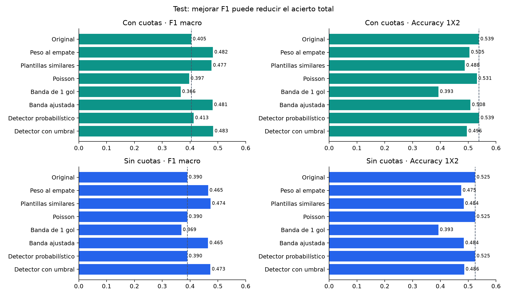

# Experimento adicional: detectar empates

Se prueban las hipótesis de diferencia de goles prevista y similitud de plantillas en las dos ramas. Es una extensión exploratoria. Los modelos principales y sus probabilidades se conservan.

**Protocolo.** Seis temporadas exteriores (2018/19–2023/24), con modelos ajustados solo con temporadas anteriores. Los parámetros de Poisson se eligen por log loss 1X2 y los del detector por log loss binario en hasta dos temporadas OOF anteriores. Las reglas de decisión se eligen por F1 macro usando esas temporadas anteriores. 2017/18 inicializa el primer fold; sus modelos usan valores iniciales fijados en el protocolo. Imputación y escalado se ajustan dentro de cada entrenamiento. La familia final se elige por F1 macro de validación, con tolerancia 0,002 a favor de la más sencilla; este uso de la validación para seleccionar familia conserva sesgo de desarrollo. El test no interviene en los ajustes, umbrales ni selección.

**Qué significa cada alternativa.** Poisson predice por separado los goles esperados de local y visitante y calcula P(H), P(D), P(A) mediante la diferencia de dos Poisson independientes. Su hipótesis de independencia es una limitación. Una diferencia **esperada** de goles ≤1 no equivale a empate: se prueba como regla, sin usar jamás los goles reales como entrada. La regla de plantilla utiliza la diferencia absoluta de rating agregado y conserva la decisión original si falta el rating. El detector aprende empate/no empate con diferencias absolutas y firmadas de fuerza, similitud de habilidades, goles e historial previos; la rama con cuotas añade probabilidades del mercado. Las valoraciones siguen siendo snapshots del juego.

**Probabilidades frente a decisiones.** Aumentar el peso del empate o aplicar un umbral puede mejorar F1 sin cambiar log loss: en esas variantes se conservan las probabilidades y se cambia solamente la clase elegida. El detector reemplaza P(D) y distribuye 1−P(D) entre H/A conservando la razón del predictor original. Se reportan F1 macro, F1 del empate, precisión y recall del empate, accuracy, frecuencia de predicción y log loss por separado.

**Señal de similitud de plantillas.** En validación, la frecuencia real de empate es 28.6% entre 6,224 partidos con diferencia de rating ≤2 y 22.9% entre 11,828 con diferencia >2; se excluyen los ratings faltantes de este diagnóstico. Es una asociación descriptiva, no causal. La similitud sí contiene señal, pero el empate sigue siendo minoría incluso entre equipos de calidad similar. No basta para decidir empate en todos esos partidos.

**Reglas congeladas para el test.** La rama con cuotas multiplica por 1.5 el valor de P(D) únicamente al elegir la etiqueta. La rama sin cuotas usa el detector y elige empate cuando P(D)≥0.275; si no, elige H/A según sus probabilidades relativas. Estos valores se eligieron con 2022/23–2023/24. Las reglas deportivas de comparación usan diferencia de rating ≤2 y bandas de goles esperados de 0.3 (con cuotas) y 0.4 (sin cuotas).

## Rama con cuotas

Familia elegida en validación: **Mayor peso al empate (decisión)**.

### validacion

| Método | F1 macro ↑ | F1 empate ↑ | Precisión empate | Recall empate | Accuracy ↑ | Predice empate | Log loss ↓ |
|---|---:|---:|---:|---:|---:|---:|---:|
| Original: mayor probabilidad | 0.4021 | 0.0040 | 0.4500 | 0.0020 | 53.87% | 0.11% | 0.965199 |
| Mayor peso al empate (decisión) | 0.4845 | 0.3297 | 0.3011 | 0.3642 | 50.93% | 30.06% | 0.965199 |
| Plantillas similares → empate | 0.4680 | 0.3311 | 0.2855 | 0.3939 | 47.97% | 34.28% | 0.965199 |
| Goles Poisson: mayor probabilidad | 0.3990 | 0.0000 | 0.0000 | 0.0000 | 53.68% | 0.00% | 0.971198 |
| Goles: diferencia esperada ≤ 1 | 0.3731 | 0.4185 | 0.2792 | 0.8351 | 39.67% | 74.34% | 0.971198 |
| Goles: banda elegida con pasado | 0.4781 | 0.3240 | 0.2958 | 0.3580 | 50.64% | 30.08% | 0.971198 |
| Detector de empate: probabilidades | 0.4103 | 0.0294 | 0.4059 | 0.0153 | 53.92% | 0.93% | 0.965622 |
| Detector de empate: umbral F1 | 0.4854 | 0.3564 | 0.3074 | 0.4240 | 50.18% | 34.27% | 0.965622 |

### test

| Método | F1 macro ↑ | F1 empate ↑ | Precisión empate | Recall empate | Accuracy ↑ | Predice empate | Log loss ↓ |
|---|---:|---:|---:|---:|---:|---:|---:|
| Original: mayor probabilidad | 0.4046 | 0.0039 | 0.5000 | 0.0019 | 53.86% | 0.10% | 0.965034 |
| Mayor peso al empate (decisión) | 0.4822 | 0.3274 | 0.2996 | 0.3610 | 50.48% | 30.94% | 0.965034 |
| Plantillas similares → empate | 0.4774 | 0.3516 | 0.3069 | 0.4117 | 48.77% | 34.44% | 0.965034 |
| Goles Poisson: mayor probabilidad | 0.3968 | 0.0000 | 0.0000 | 0.0000 | 53.11% | 0.00% | 0.972257 |
| Goles: diferencia esperada ≤ 1 | 0.3663 | 0.4224 | 0.2830 | 0.8325 | 39.31% | 75.51% | 0.972257 |
| Goles: banda elegida con pasado | 0.4811 | 0.3272 | 0.3023 | 0.3565 | 50.81% | 30.27% | 0.972257 |
| Detector de empate: probabilidades | 0.4131 | 0.0287 | 0.3710 | 0.0149 | 53.94% | 1.03% | 0.965845 |
| Detector de empate: umbral F1 | 0.4831 | 0.3564 | 0.3044 | 0.4299 | 49.56% | 36.26% | 0.965845 |

validacion: frente al original, Δ F1 macro **+0.0824**, IC 95% [+0.0759, +0.0887]; Δ accuracy **-2.94 puntos porcentuales**, IC [-3.61, -2.29].

test: frente al original, Δ F1 macro **+0.0776**, IC 95% [+0.0675, +0.0877]; Δ accuracy **-3.38 puntos porcentuales**, IC [-4.43, -2.34].

## Rama sin cuotas

Familia elegida en validación: **Detector de empate: umbral F1**.

### validacion

| Método | F1 macro ↑ | F1 empate ↑ | Precisión empate | Recall empate | Accuracy ↑ | Predice empate | Log loss ↓ |
|---|---:|---:|---:|---:|---:|---:|---:|
| Original: mayor probabilidad | 0.3925 | 0.0000 | 0.0000 | 0.0000 | 53.11% | 0.00% | 0.977711 |
| Mayor peso al empate (decisión) | 0.4682 | 0.3075 | 0.2860 | 0.3324 | 49.80% | 28.88% | 0.977711 |
| Plantillas similares → empate | 0.4658 | 0.3308 | 0.2855 | 0.3932 | 47.72% | 34.23% | 0.977711 |
| Goles Poisson: mayor probabilidad | 0.3941 | 0.0000 | 0.0000 | 0.0000 | 53.15% | 0.00% | 0.979229 |
| Goles: diferencia esperada ≤ 1 | 0.3767 | 0.4145 | 0.2787 | 0.8084 | 39.93% | 72.09% | 0.979229 |
| Goles: banda elegida con pasado | 0.4668 | 0.3249 | 0.2903 | 0.3689 | 49.46% | 31.58% | 0.979229 |
| Detector de empate: probabilidades | 0.3931 | 0.0018 | 0.6667 | 0.0009 | 53.12% | 0.03% | 0.978492 |
| Detector de empate: umbral F1 | 0.4742 | 0.3413 | 0.2955 | 0.4039 | 48.78% | 33.96% | 0.978492 |

### test

| Método | F1 macro ↑ | F1 empate ↑ | Precisión empate | Recall empate | Accuracy ↑ | Predice empate | Log loss ↓ |
|---|---:|---:|---:|---:|---:|---:|---:|
| Original: mayor probabilidad | 0.3902 | 0.0000 | 0.0000 | 0.0000 | 52.49% | 0.00% | 0.979070 |
| Mayor peso al empate (decisión) | 0.4649 | 0.3601 | 0.2901 | 0.4747 | 47.49% | 42.01% | 0.979070 |
| Plantillas similares → empate | 0.4737 | 0.3514 | 0.3068 | 0.4110 | 48.39% | 34.39% | 0.979070 |
| Goles Poisson: mayor probabilidad | 0.3904 | 0.0000 | 0.0000 | 0.0000 | 52.49% | 0.00% | 0.981132 |
| Goles: diferencia esperada ≤ 1 | 0.3689 | 0.4150 | 0.2801 | 0.8000 | 39.29% | 73.31% | 0.981132 |
| Goles: banda elegida con pasado | 0.4647 | 0.3464 | 0.2919 | 0.4260 | 48.42% | 37.46% | 0.981132 |
| Detector de empate: probabilidades | 0.3902 | 0.0000 | 0.0000 | 0.0000 | 52.49% | 0.00% | 0.980248 |
| Detector de empate: umbral F1 | 0.4731 | 0.3382 | 0.2951 | 0.3961 | 48.56% | 34.46% | 0.980248 |

validacion: frente al original, Δ F1 macro **+0.0816**, IC 95% [+0.0755, +0.0878]; Δ accuracy **-4.33 puntos porcentuales**, IC [-5.04, -3.60].

test: frente al original, Δ F1 macro **+0.0829**, IC 95% [+0.0729, +0.0925]; Δ accuracy **-3.93 puntos porcentuales**, IC [-5.10, -2.79].

## Alcance de la comparación

Los intervalos usan 5.000 bootstrap por bloques de temporada/año ISO/semana. Son intervalos exploratorios condicionados al procedimiento; no corrigen la selección de la familia ni toda la multiplicidad de la exploración. No se mezclan las predicciones de decisión con el cálculo de log loss ni se sustituyen probabilidades por etiquetas 0/1.

Ejecución: `b34a5d5e31a13e1d`. Resultados, configuraciones por fold, selección congelada, predicciones y modelos guardados en `scripts/data/draw_runs/b34a5d5e31a13e1d`. El predictor exportado ofrece `predict_proba(frame)` y `predict(frame)`; las dos salidas pueden diferir de argmax cuando el objetivo de decisión es F1.

Reproducción: `.venv/bin/python scripts/experiment_draws.py`.

